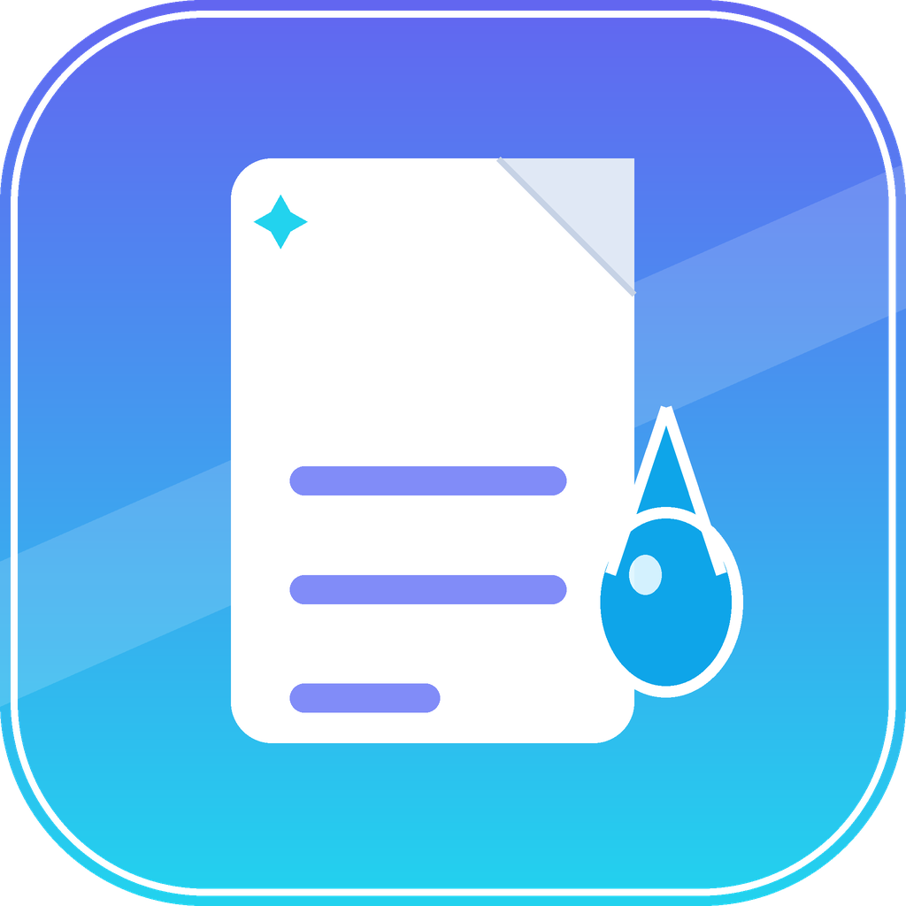

<div align="center">
  
  <h1>Inkwell</h1>
  <p><strong>A calm, local-first Markdown studio for your desktop.</strong></p>
  <p>Write in Markdown, preview it live, ask AI about it, listen to it, translate it, print it, and send it anywhere.</p>

  <p>
    <a href="https://github.com/alisoltanics/inkwell/releases/latest"></a>
    
    
  </p>

  <p>
    <a href="#screenshots">Screenshots</a> &middot;
    <a href="#features">Features</a> &middot;
    <a href="#install">Install</a> &middot;
    <a href="#run-from-source">Build from source</a> &middot;
    <a href="#keyboard-shortcuts">Shortcuts</a>
  </p>
</div>

---

> **Your notes stay yours.** Inkwell works on ordinary `.md` files in a folder you choose. No account, no proprietary database, no lock-in.

## Why Inkwell

| | |
| --- | --- |
| **Local by design** | Your vault is a normal folder of Markdown files, images and PDFs. Open it with any editor, sync it with any service, back it up like any other folder. |
| **One focused workspace** | Edit, preview and organize notes in the same window, with tabs, favorites, comments, archive and a file tree that follows changes on disk. |
| **AI without a second app** | Ask about a selection, summarize a document, proofread, build flashcards or a glossary, and review changes before they touch the note. |
| **From phone to vault** | A private Telegram inbox turns messages into notes and files, lets you browse the vault and append to a default file from the chat. |

## Screenshots

<p align="center">
  
</p>

| Split view | AI tools | Flashcards |
| --- | --- | --- |
|  |  |  |

## Features

### Writing workspace

- Create, rename, move, search and delete Markdown files and nested folders.
- Keep frequently used notes in **Favorites**, open several notes in **tabs**, and archive anything you want out of the way.
- Drag files and folders to reorganize them. A note, image, PDF or HTML file keeps its extension when it moves.
- Choose the vault folder in **Settings**. Notes are saved as you type, and external changes — from another editor, a sync folder, the VS Code extension or Telegram — appear on their own.
- The open note reloads in place when its file changes on disk, without losing the caret or scroll position, and never overwrites unsaved edits.
- Add comments to selected passages, revisit them from the comments panel, and keep them attached to the same paragraph in the translated view.
- Images and PDFs sit in the same tree as notes. Images open in a zoomable viewer (25%–400%); PDFs open in the built-in viewer with **Open in the default app** and **Show in folder**.
- Add images with paths relative to the vault; the preview embeds them and can open them full-screen.
- Hover a file to see its full path. Selecting text also offers **Copy**.

### Markdown and reading

- Work in **Edit**, **Preview** or **Split** view. Resize the divider or double-click it to reset.
- **Edit** renders the note like the preview: click any block to edit just that block's Markdown, with the rest of the note left untouched. Press `Ctrl + Enter` or click the check to finish.
- GitHub Flavored Markdown: tables, task lists, footnotes, emoji, highlights, inserted text, subscript and superscript.
- Fenced code blocks with syntax highlighting, and inline or display math with KaTeX.
- Automatic, LTR or RTL text direction. Automatic mode handles mixed Persian and English paragraphs while keeping code, tables and math LTR.
- Zoom the document from 50% to 250%.
- In **Settings → Appearance**, scale the whole interface from 80% to 150% and choose a theme: Dark, Light, VS Code Dark, ChatGPT, GitHub, Nord, Dracula, Solarized Dark, Solarized Light, Sepia or Rose.
- Switch the interface language: English, فارسی, العربية, Français, Deutsch, Italiano, Türkçe, Español or 中文. Persian and Arabic mirror the whole app to right-to-left; each document keeps its own direction.

### AI tools

- Open **Ask AI** to ask a question about the open note. Document actions — summarize, explain, translate, extract notes, create a quiz, build flashcards, build a glossary and proofread — live in the AI tools menu.
- A document action sends **only the open note**. The note is passed inside the prompt, the CLI runs in an empty scratch folder, and Claude's own tools, instructions, skills and MCP servers are disabled — so the answer cannot wander into the rest of your vault.
- Select text to get a small action bar: **Ask AI**, **Explain**, **Rewrite**, **Copy**, **Comment**, and **Explain code** for code selections.
- Review AI edits before accepting: removed text is marked red, proposed text green, and every proofreading suggestion is accepted or rejected separately.
- Keep an answer with its passage: **Save to passage** marks the paragraph in violet and stores the explanation with the note. Click the mark later to reopen the answer.
- Build flashcards as a clickable deck, then save them as a note or insert them as Markdown. A saved deck is a `flashcards` block of `Q:`/`A:` lines and renders the same way in the preview, the AI answer page and printed or exported HTML.
- Build a glossary of terms, names and acronyms as a definition list, then save or insert it as portable Markdown.
- Save any answer as a new note, or send it to Telegram as HTML or Markdown.
- Choose Claude, Codex or OpenCode, set a model, and manage reusable quick prompts.
- Add custom CLI providers with a command, type, model flag and optional environment variables. Add HTTP providers with a base URL and API key; the model list is read from the service. **Test**, **Edit** and **Remove** are available for every provider.
- DeepSeek is pre-added for HTTP use: paste a key in **Settings → AI** and the base URL `https://api.deepseek.com/v1` is already there. The model list updates from the service.
- Base URLs are forgiving: `https://api.x.com`, `https://api.x.com/v1` and a full `/v1/chat/completions` URL all work. If a service answers 404, Inkwell tries the neighbouring shape and reports the exact URL it used.

> Inkwell does not provide an AI model or account. It starts the CLI installed on your computer (`claude`, `codex` or `opencode`) and uses that client's local setup and authentication. HTTP providers are called directly with your key. The prompt and any included note text go to the provider you chose; review that service's privacy terms before sending sensitive content.

<details>
<summary><strong>How prompts are passed to AI providers</strong></summary>

- The prompt is written to the CLI's standard input, not the command line. This keeps a whole note intact on Windows, where a command line stops at about 8,000 characters and `cmd.exe` would expand `%VAR%` and `!var!` inside the text.
- A custom CLI that insists on an argument is still supported. A request that would be too long for it is refused with a clear message instead of being truncated.
- Answers are read as UTF-8, so Persian, Arabic and Chinese output is not damaged when a pipe splits a character.
- For Claude, Inkwell reads `claudeCode.environmentVariables` from the local VS Code user `settings.json` when present and passes those variables to the CLI process.

</details>

### Read aloud and translate

- A speaker button appears for every note with text. One click records it and starts playback; the audio is stored in `.inkwell/audio` inside the vault and plays again without re-recording.
- The player has play/pause, a position slider, speed from 0.75× to 2× (remembered), **Regenerate** and **Close**. Editing the note makes a new recording next time and removes the previous one.
- Voice engines are chosen best-first: `piper` (neural, put a `.onnx` model in `~/.local/share/piper` or set `PIPER_MODEL`), `pico2wave`, `espeak-ng`, then the built-in `say`/SAPI voices on macOS and Windows. If no system voice can write audio, Inkwell uses an OpenAI-compatible speech API with a key from **Settings → AI** or `OPENAI_API_KEY`.
- Pick **Best available**, **System voice only** or **AI voice only** in **Settings → AI → Read aloud**. The badge shows which voice will actually be used. Engines with several voices can be auditioned with **Test voice**.
- Translate a selected passage or the whole note. **Argos Translate** runs offline when installed (`pip install argostranslate` plus the language pair); otherwise the selected AI engine does the work.
- A saved translation is kept with the note. The preview can switch between the original and the translation, and the translation follows the direction of its own language while the original keeps the direction you chose.
- **Save as file** writes the translation beside the note (`flow-en.md`), and a second save keeps both (`flow-en-2.md`).
- Comments, saved answers and selections continue to work in translation view: they are stored against the matching paragraph of the original note.

### Print, export and share

- **Export as HTML** writes a self-contained page beside the note, with local images, fonts, formulas and styles embedded. It appears in the file list immediately and is ready to share or print.
- **Print preview** opens the document in an A4 preview window before anything is sent to a printer. The preview has **Print…** and **Close** buttons; the toolbar is hidden from the printed page, so only the document reaches paper.
- Printing, exporting and Telegram sharing use whatever the preview is showing. A note left in translation view is printed, exported or sent as the translation, named after the target language.
- **Send to Telegram** asks for HTML (one self-contained page) or Markdown (the plain `.md` text). The choice is remembered; a `.docx` or `.html` note is sent as HTML.

### Telegram inbox

Configure a bot token and chat ID in **Settings → Telegram**, send a test message, then use the chat as a remote inbox.

- **Write from your phone.** Every text message opens a **folder picker**, then asks for a **file name**. Choose the folder you are viewing, the **Default path** from settings, or **Append to …** for the default append file.
- The HTML of a note you just sent to the bot comes back **without a password** — you wrote that text yourself. The send password protects files read out of the vault with `/files`.
- Files and photos from the phone are always saved into `Telegram/`, keeping their name and extension. That folder gets its own tinted sidebar section and is excluded from the notes tree, so nothing appears twice.
- A note created from a message keeps its arrival time in an HTML comment, flashes in the file list, and refreshes the app on its own.
- **Persistent button menu.** `/menu` (or `/start`) pins a keyboard under the chat with **Browse files**, **List notes**, **Append file**, **Clear append**, **Remove default**, **Status** and **Help**. The buttons stay under the text box while you type.
- **Clear append** asks for confirmation and empties the default append file, keeping the file and the default setting. **Remove default** only unsets the default and leaves the file untouched.
- **Browse the vault.** `/files` turns the vault into buttons with folders, *Up*, *Vault* and paging. Markdown and text become the same standalone HTML as an export; `.docx` is converted; HTML, images, PDFs and other files are sent exactly as they are in the vault.
- **Command menu.** Enabling the inbox registers `/menu`, `/to`, `/new`, `/status`, `/files`, `/clear`, `/cancel` and `/help` for that chat only, in English and Persian. A bot shared with other tools keeps its global command list.
- **Defaults from the phone.** `/to Note.md` sets the append file, `/new` removes that default, `/status` shows both defaults, and `/help` lists every command. A plain name is matched anywhere in the vault, case-insensitively; a note named `Inbox.md` answers to `inbox.md`.
- **Cached uploads.** Telegram returns a `file_id` for every uploaded document. Inkwell keeps it and re-sends the same content from that id without uploading the bytes again — a second send of a large PDF or image is instant. The cache is tied to the bot, chat and exact content, so an edited note uploads anew; a stale id falls back to a normal upload. Entries expire after 60 days.
- **Limits and safety.** Files over Telegram's 20 MB bot-download limit are refused with the reason. `/clear Note.md` empties a note only after the same command is sent twice within a minute. The update offset is stored, so a restart never imports the same message twice, and the first start imports only the last day of messages.

## Privacy and security

Inkwell keeps your vault and settings on your computer.

- The vault contains ordinary, unencrypted Markdown files and any images or PDFs you add. Choose a folder outside the Inkwell source repository; if a vault is inside a Git repository, its contents may be committed unless that path is ignored.
- Preferences, vault location and Telegram settings live in Electron's local application data directory, not in the project files. The settings file is written with owner-only permissions (`0600`).
- Telegram credentials and AI API keys are stored locally and are never put in the project or sent to GitHub. The Telegram bot token is only used to talk to the Telegram API.
- **One chat, one account.** A Telegram message is accepted only from the saved chat ID and, in a group, only from the account that wrote first after the inbox was turned on. Turning the inbox off and on pins it to the next account that writes.
- **The vault is a wall.** Every note name from the phone (`/to`, `/clear`) is resolved and refused if it leaves the vault. `../` tricks cannot read or empty a file outside it, and incoming files are stored under their plain name inside the vault.
- **The token is the bot.** Whoever holds the bot token can act as that bot and receive messages sent to it, so keep it private. It does not give direct access to your vault; the bot only reads what you send and only replies to the configured chat. If the token leaks, revoke it with BotFather and paste a new one.
- The inbox needs Inkwell open and polling `getUpdates`, so the bot must not have a webhook set (Telegram allows one or the other). Settings says so if that happens.

## Install

Open the [latest Inkwell release](https://github.com/alisoltanics/inkwell/releases/latest) and download the file for your system.

### Linux

| Package | How to use |
| --- | --- |
| **Debian / Ubuntu** | Download the `.deb` and open it with your software installer, or run `sudo apt install ./inkwell_VERSION_amd64.deb`. |
| **Other distributions** | Download the `.AppImage`, make it executable, then run it: `chmod +x Inkwell-VERSION.AppImage && ./Inkwell-VERSION.AppImage`. |

### Windows

| Package | How to use |
| --- | --- |
| **Inkwell Setup** | Guided install with Start Menu and optional desktop shortcuts. |
| **Inkwell portable** | Run the single `.exe` without installing. |

### macOS

Download the `.dmg` for your Mac: the filename with `arm64` is for Apple Silicon; the other build is for Intel. Open the `.dmg` and drag Inkwell to **Applications**.

> These builds are unsigned. If macOS blocks the first launch, Control-click the app and choose **Open**.

## Run from source

**Requirements:** Node.js 20 or newer and npm. AI features need the CLI for your chosen provider, installed and signed in separately — or an API key for an HTTP provider such as DeepSeek.

```bash
git clone https://github.com/alisoltanics/inkwell.git
cd inkwell
npm install
npm start
```

Build an installer for the current platform:

```bash
npm run build:linux   # AppImage and .deb on Linux
npm run build:win     # NSIS installer and portable .exe on Windows
npm run build:mac     # .dmg and .zip on macOS
```

Version tags matching `v*` trigger GitHub Actions to build Linux x64, Windows x64, macOS Intel and Apple Silicon installers, then attach them to a GitHub release.

## Keyboard shortcuts

| Action | Shortcut |
| --- | --- |
| Save now (edits also save automatically) | `Ctrl/Cmd + S` |
| New file | `Ctrl/Cmd + N` |
| Toggle preview | `Ctrl/Cmd + P` |
| Split view | `Ctrl/Cmd + \` |
| Toggle sidebar | `Ctrl/Cmd + Shift + B` |
| Bold / italic | `Ctrl/Cmd + B` / `Ctrl/Cmd + I` |
| Strikethrough | `Ctrl/Cmd + Shift + X` |
| Insert link | `Ctrl/Cmd + K` |
| Ask AI about selection | `Ctrl/Cmd + J` |
| Print preview | `Ctrl/Cmd + Shift + P` |
| Export as HTML | `Ctrl/Cmd + Shift + E` |
| Zoom in / out / reset | `Ctrl/Cmd + +` / `-` / `0` |
| Close dialog or panel | `Esc` |

## Project layout

| Path | What it contains |
| --- | --- |
| `main.js` | Electron main process: local files, AI CLI integration, Telegram, printing and HTML export. |
| `preload.js` | Restricted bridge between the UI and the main process. |
| `print-preload.js` | Minimal bridge for the sandboxed print preview window. |
| `html.js` | Builds self-contained HTML exports and print pages. |
| `src/telegram-html.js` | Renders notes written from Telegram as standalone HTML. |
| `src/renderer/` | Application interface, Markdown rendering and themes. |
| `docs/screenshots/` | Screenshots used in this README. |
| `vscode-extension/` | **Inkwell Preview**, a VS Code extension that previews Markdown with this renderer and can copy the open note into the vault. |
| `.github/workflows/release.yml` | Cross-platform release build workflow. |

## Credits

- **Ali Soltani** — design, code and releases.
- **DeepSeek** — AI pair-programmer on this repository: features, refactors and the headless test harnesses used before each release.

---

<p align="center"><sub>Built with care for people who think in Markdown.</sub></p>
