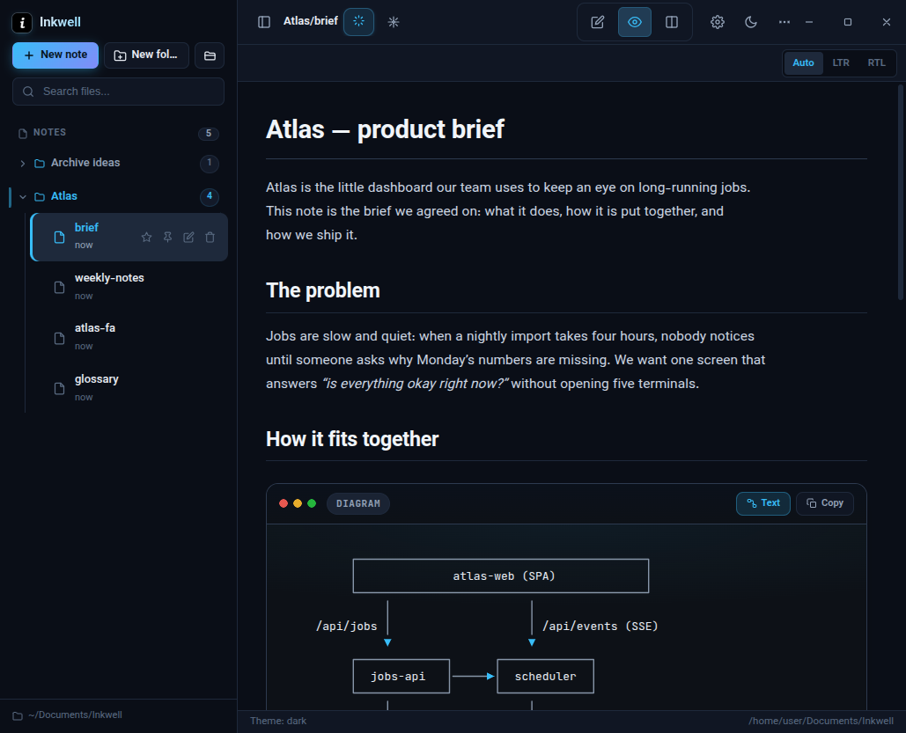
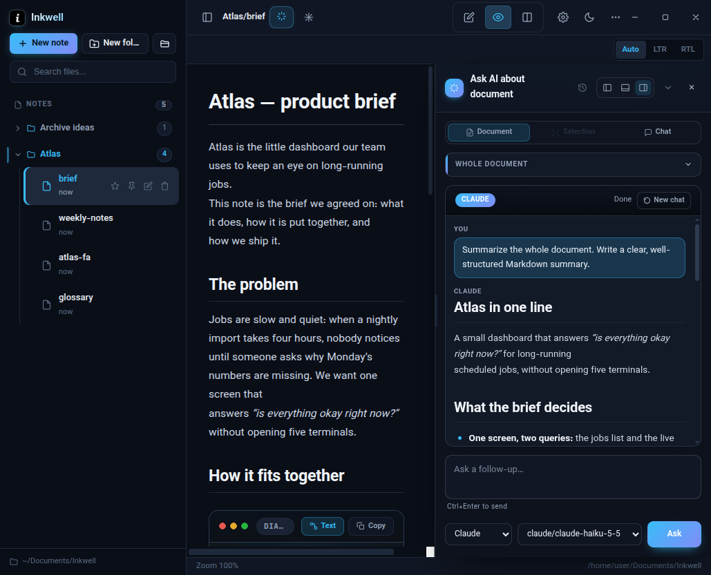
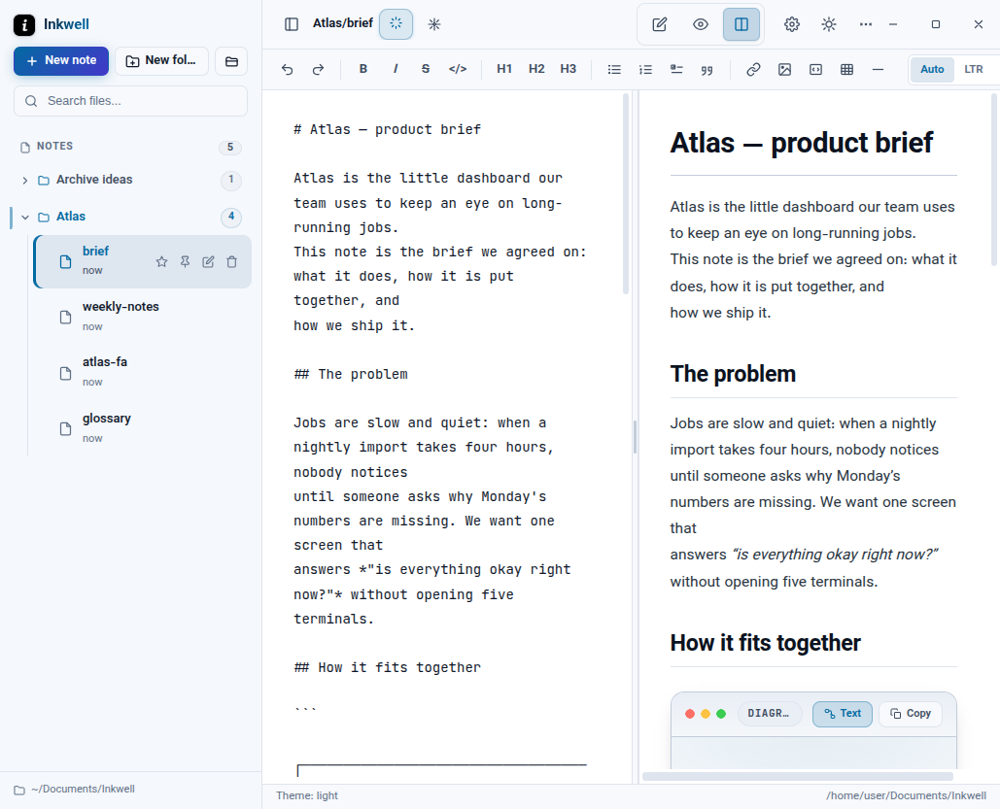
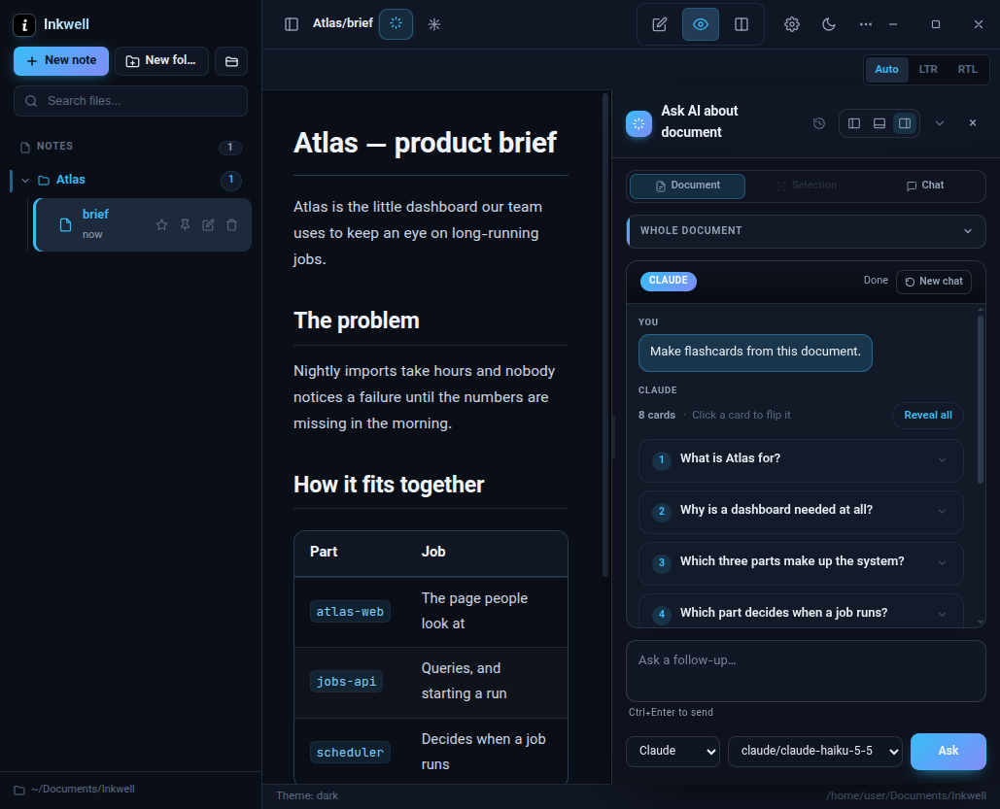

# Inkwell

Inkwell is a desktop Markdown writing app for organizing notes as regular files and working with them in a focused editor. It is built with Electron and runs on Linux, Windows, and macOS. Notes are readable `.md` files on your computer; Inkwell does not encrypt them or require an Inkwell account.

## Screenshots

| Reading and previewing | Asking the AI about a document |
| --- | --- |
|  |  |
| **Split view in the light theme** | **Flashcards built from a document** |
|  |  |

## What Inkwell does

### Write and organize

- Create, rename, move, search, and delete Markdown files and nested folders.
- Choose a vault folder in Settings, or select one when creating your first file or folder. The vault is the folder where Inkwell stores your notes.
- Drag files and folders into other folders to reorganize them.
- Star a note to keep it in the Favorites section at the top of the sidebar, so frequently used documents are one click away. Renaming or moving a note keeps it in that section.
- Archive a note or a whole folder (right-click → Archive) to move it out of the notes tree. Archived items live in the hidden `.inkwell/archive` folder inside the vault and are listed in the Archive section of the sidebar, where they can be opened without leaving the archive, restored to their original place, or deleted permanently.
- Pin notes to the tab bar above the editor, and switch between them without leaving the current view.
- Changes are saved as you type. Notes can also be edited with any text editor.
- The list follows the vault: a note created, renamed or deleted outside the app (another editor, a sync folder, the VS Code extension, a Telegram message from your phone) shows up on its own. The note you are reading reloads in place when its file changes on disk — caret and scroll stay where they were — and unsaved edits in the editor are never overwritten by that reload.
- Add images using paths relative to the vault. Images appear in the preview and can be opened full-screen.
- Add comments to selected passages, revisit them from the comments panel, and edit or remove them. The comment box opens toward the left when the selection is near the right edge.
- Hover a file or folder in the sidebar to see its full path. Selecting text also offers a Copy action.

### Edit and preview Markdown

- Work in Edit, Preview, or Split view. Resize the editor/preview divider and reset it with a double-click.
- Use the formatting toolbar for emphasis, headings, lists, task lists, quotes, links, images, code, tables, and horizontal rules.
- Render GitHub Flavored Markdown, tables, task lists, footnotes, emoji, highlighted text, inserted text, subscript, and superscript.
- Highlight fenced code blocks and render inline and display LaTeX math with KaTeX.
- Choose automatic, left-to-right, or right-to-left text direction. Automatic direction supports mixed Persian and English paragraphs; code, tables, and math remain left-to-right.
- Zoom the document from 50% to 250%.
- In Settings → Appearance, scale the whole app's font size from 80% to 150% and pick a color theme: Dark, Light, VS Code Dark, Nord, Dracula, Solarized Dark, Solarized Light, Sepia, or Rose.
- Switch the interface language in Settings → Appearance: English, فارسی, العربية, Français, Deutsch, Italiano, Türkçe, Español, or 中文. Persian and Arabic flip the whole app to right-to-left (sidebar, toolbars, menus and dialogs mirror), while each document keeps its own text direction.
- Export a self-contained HTML copy of a document. The export is written next to the note, appears in the file list immediately, and includes local images, so it is suitable for sharing or printing.
- Print the current document from the header button or with Ctrl+Shift+P. The printed page uses the same styling as the exported HTML.

### Listen to a note

- A speaker button appears in the header for every note that has text. One click records the note and starts playing it; the audio is stored in the hidden `.inkwell/audio` folder inside the vault, so it is still there after a restart and plays again without asking the voice engine. A long note is read by the system voice in one go, and the AI voice is called in sentence-sized chunks (about 4,000 characters each) that are joined into a single file.
- The player has play/pause, a position slider, playback speed from 0.75× to 2× (remembered), Regenerate to record the current text again, and Close. Editing the note makes a new recording the next time, and the previous recording of that note is removed.
- The system voice is used first, best quality first: `piper` (a neural voice — put a `.onnx` model in `~/.local/share/piper` or point `PIPER_MODEL` at one), then `pico2wave`, then `espeak-ng` (slower rate and MBROLA voices when they are installed), and on macOS/Windows the built-in `say`/SAPI voices. When no system voice can write audio, Inkwell calls an OpenAI-compatible speech API instead: paste a key under Settings → AI → *Read aloud — AI voice key* (or set `OPENAI_API_KEY`). With no key either, the note is still read aloud by the operating system's own speaker (speech-dispatcher, `say`, SAPI); that voice is not saved. Code blocks are skipped and Markdown marks are not read out loud.
- Pick the engine in Settings → AI → *Read aloud*: `Best available`, `System voice only` (offline, never calls an API), or `AI voice only`. The badge next to the section shows which voice will actually be used on this machine. While an offline voice is reading, the player offers **Use an AI voice…**, which opens that section with the key field ready.
- Engines that ship several voices (espeak and speech-dispatcher list dozens, from `klatt` to `female3`) can be auditioned: choose one under *System voice* and press **Test voice** to hear it before saving.

### Translate a passage

- Select text in the editor and choose **Translate**. The dialog suggests the source and target languages, both are pickers, and the translation runs when **Translate** is pressed — the same as for a whole note. The arrow between the two pickers swaps them, and the dialog shows the passage with its word count above the result.
- The work is done on this machine by **Argos Translate** when it is installed (`pip install argostranslate` plus the language pair); otherwise the AI picked in the dialog's Engine row translates it, and the engine line under the pickers says which one produced the text.
- **Save to note** keeps the passage marked with a light blue highlight in the preview. Clicking the highlight reopens the translation in a small card, where it can be copied or removed. **Try again** re-runs the translation, and the target picker translates again immediately.
- Saved translations are stored with the app settings per note, like comments, and follow a rename or a delete. A passage keeps one translation, so translating it again replaces the earlier one instead of stacking a second highlight.

### Translate a whole note

- Pick **Translate** in the header's AI tools menu to translate the entire note. The dialog shows the text it is about and both languages — where it comes from and where it goes — suggested but yours to change, and nothing is translated until **Translate** is pressed.
- The same dialog says who does the work: **Engine** is *Offline first, then AI* (Argos Translate when it is installed), *Offline only*, or *AI only*, and the AI provider and model are picked next to it. A long note is translated in paragraph-sized pieces, so the AI is not handed one huge command and the progress is counted.
- **Save translation** keeps the result with the note and switches the preview to the translated text, laid out in the direction of the target language. The editor keeps the original, and translating the note again replaces the stored translation instead of adding a second one.
- A translation button then appears in the toolbar next to the direction buttons: click it to switch the preview between the note and its saved translation, and back. It only shows for notes that have a saved translation, and only the translation turns right-to-left when its language needs it — the note and the editor keep the direction you chose for them.
- While a translation is on screen the direction buttons lay out the translation only, so picking LTR for the translated text leaves the note's own direction alone.
- Comments stay usable in both views: a comment written on the note is marked on the same paragraph of the translation, and a comment added while reading the translation is stored against the original passage, so it appears in both.
- Selecting text while reading the translation acts on that text — Ask AI, Explain and Translate take exactly what was selected — while comments and saved answers are stored against the matching paragraph of the note, so they show up in both views.
- **Save as file** writes the translation as its own note beside the one it came from (`flow-en.md`), so it can be opened, searched and edited like any other note. Saving a second time keeps both (`flow-en-2.md`).
- Printing, exporting and sending to Telegram use whatever the preview is showing, so a note left in translation view is printed, exported and sent as the translation (the sent file is named after the target language).

### Ask AI

- Open the Ask AI panel to ask a question. The document actions (summarize, explain, translate, extract notes, create a quiz, make flashcards, proofread) are in the AI tools menu in the header.
- A document action sends **only the open note**, never the other notes of the folder. The note goes inside the prompt, the request says that it is the only source, and the CLI runs in an empty scratch folder while it answers — so it has nothing else to read, and no `AGENTS.md`/`CLAUDE.md` from the vault is picked up. For Claude the tools are switched off and its own instructions, skills and MCP servers are skipped (`--tools ''`, `--safe-mode`, `--strict-mcp-config`). Switching to another note starts a fresh conversation, so an answer is never written with the previous note in view.
- Build flashcards from a document: the answer opens as a deck of numbered cards, each showing the question until you click it to reveal the answer. Use **Reveal all** / **Hide all** to toggle the whole deck, then save it as a note or insert the cards as Markdown. Saved decks are written as a `flashcards` block of `Q:` / `A:` lines and render as the same clickable deck in the preview, in the AI answer page, and in printed or exported HTML (where every answer is shown).
- Build a glossary of the document: the terms, names and acronyms it uses are listed alphabetically with a short definition and a type tag (person, place, concept, acronym, product…). The list is shown as a definition list in the AI panel, and Save/Insert write it as a plain Markdown bullet list so it stays portable.
- Select text in the editor to get a small action bar: Ask AI about the selection, Explain it, ask AI to change it, copy it, or add a comment. When the selection is code (a fenced block, inline code, or code-looking lines) an **Explain code** action appears too and sends a ready-made explanation prompt to the AI immediately.
- The bar opens under the pointer that finished the selection, in the editor and in the preview alike (a selection made with the keyboard puts it at the end of the selected text).
- Ask AI about selected text, or explain a piece of code. AI prompts can include the selected text or document content needed for the chosen action.
- Keep an answer with the passage it is about: **Save to passage** in the answer's actions menu marks the passage in a soft violet and stores the explanation with the note. Clicking the mark later opens the explanation in a small card with the passage on top, where it can be copied or removed. The mark also follows the note into translation view, so the explanation stays next to the same paragraph.
- Ask AI to edit a selected passage or insert text at the cursor. Review the full Markdown preview with removed text marked red and proposed text highlighted green in place, then accept or reject the change. Accepted changes are saved to the open note; if the note changes while AI is working, Inkwell asks you to generate a fresh proposal.
- Proofread a document to check grammar, spelling, and wording. Each suggested fix is reviewed separately in the document, showing the original and proposed text, so you can accept or reject it one by one.
- Choose Claude, Codex, or OpenCode, set a model, and manage reusable quick prompts in Settings.
- The prompt is handed to the CLI on its input, not on the command line, for all three of them. That keeps a whole note intact on Windows too, where a command line stops at about 8000 characters (a long document would otherwise be cut, and `cmd.exe` would also expand `%VAR%` and `!var!` inside the text). A custom CLI provider that insists on an argument is still supported, and a request that would be too long for it is refused with a clear message instead of being truncated.
- Every answer is read as UTF-8 text, so Persian, Arabic or Chinese output is not damaged when a pipe splits a character in half — this holds for the AI answer, the offline translator, and the term list of a glossary.
- Add custom CLI providers in Settings with a command, type, model flag, and an optional base URL and API key. These are passed to the command as environment variables (`ANTHROPIC_*` for Claude-type providers, `OPENAI_*` otherwise; the names can be changed). They are stored in Inkwell's local settings.
- The same form adds an **HTTP provider** with no CLI at all: pick the type `api`, give it a name, a base URL (`https://…/v1`) and your key. The key goes straight to the app's settings file on this device — it is never kept in the page's preferences — and the provider appears in the model picker, with its model list read from the service. Leave the key empty to add the provider first and fill the key in under *Model* afterwards.
- The Base URL is forgiving: `https://api.x.com`, `https://api.x.com/v1` and the full `https://api.x.com/v1/chat/completions` copied from a docs page all work — Inkwell tries the neighbouring shape when a service answers 404, and the error message names the exact URL it tried.
- Every provider row has **Test**, **Edit** and **Remove**. Test asks the provider for its model list and reports what happened (a rejected key, a 404 with the URL, or "Connected · N models"), and the same result appears under the form while you fill it in. Edit reopens the form with the provider's settings; the ID stays fixed (the saved key belongs to it) and leaving the key field empty keeps the saved key.
- Use a service that only offers an HTTP API, with no CLI to install: providers of type `api` (OpenAI compatible) are called directly by Inkwell. DeepSeek is pre-added — paste your API key in Settings → AI, and the base URL (`https://api.deepseek.com/v1`) is already filled in. Inkwell reads the model list from the service as soon as a key is saved, so new models (DeepSeek V4.1 Flash, V4 Pro, …) appear on their own; `DEEPSEEK_API_KEY` in the environment works as well. The key is written to Inkwell's own settings file with owner-only permissions and is never kept in the page state or sent back to the interface.
- Save a useful AI answer as a new Markdown note.
- Send an AI answer to Telegram in one click: a small dialog asks for the file type — a self-contained HTML page (titled with the action and the note, flashcard decks with every answer visible) or the plain Markdown — and sends it to the chat configured in Settings → Telegram. If Telegram is not set up yet, the settings open on that tab.

Inkwell does not provide an AI model or AI account. It starts the selected command-line client installed on your computer (`claude`, `codex`, or `opencode`) and uses that client's local setup and authentication. For Claude, Inkwell runs the `claude` CLI. It also reads `claudeCode.environmentVariables` from the local VS Code user `settings.json`, when present, and passes those environment variables to the CLI process. HTTP providers are different: Inkwell sends the request itself to the base URL you configured, with your API key, and the key never leaves your machine except towards that service. Inkwell does not put these credentials in the project or send them to GitHub. When you submit an AI request, the prompt and any included note text are sent by the selected CLI or HTTP provider to the AI service configured there; review that service's privacy terms before sending sensitive content.

### Share with Telegram

- Configure a Telegram bot token and chat ID in Settings, send a test message, and send the current document.
- Sending asks for the file type: **HTML** (one self-contained page with the styles, formulas and images inside it) or **Markdown** (the plain `.md` text, exactly what the editor holds — or the saved translation when the translation is on screen). The choice is remembered and highlighted the next time. A `.docx` or an `.html` note only has a preview, so it is sent as HTML.
- Telegram credentials are kept in Inkwell's local application settings. They are not stored in the project repository.
- **Write from your phone**: turn on *Write from your phone* in Settings → Telegram and every message you send to the bot is written into the vault — a new note in `Inbox/`, or a message appended to the note you pick in *Where they go*. The note keeps the arrival time in an HTML comment, the list refreshes on its own (a new note is flashed like any file that arrives from outside), and only messages from the configured chat are accepted, and empty messages are ignored. The update offset is stored, so a restart never imports the same message twice, and the first start only imports the last day of messages.
- The chat shows a **command menu**: enabling the inbox (or *Show commands in Telegram*) registers `/to`, `/new`, `/status` and `/help` for that chat only — in English and Persian — so typing `/` in Telegram lists them with a one-line description. A bot that other tools also use keeps its global command list untouched.
- Send a **file** (or a photo) to the bot and it is saved into the vault next to the note the messages go into, with its own name and extension — a Markdown file opens as a document, a PDF or an image is kept as a file. Name clashes get a number (`report 2.pdf`), and a file over Telegram's 20 MB bot-download limit is refused with the reason.
- `/list` prints the notes as a tidy tree (folders, counts, “and N more”), and `/list <word>` narrows it down; `/clear Note.md` empties a note but only after the same command is sent twice within a minute, so a tap in the chat can never wipe a document by accident.
- Where the messages go can be chosen **from the phone**, without opening the app: `/to Note.md` writes into that note (a plain file name is matched anywhere in the vault, and the note is created if it does not exist), `/new` goes back to one note per message, `/status` says where the next message will land, and `/help` lists the lot. The bot answers each command, and the Settings pane follows along.
- The inbox needs Inkwell open and polling `getUpdates`, so the bot must not have a webhook set (Telegram allows one or the other); the settings line says so if that is the case.

## Your files and privacy

The vault contains ordinary, unencrypted Markdown files and any images you add. Choose a folder outside the Inkwell source repository for your vault. If a vault is inside a Git repository, its contents may be committed unless that path is ignored. The `.gitignore` excludes common local folders, build output, environment files, logs, and editor/OS files, but it cannot know the path of every custom vault.

Inkwell's preferences, vault location, and Telegram settings are stored in Electron's local application data directory, not in the project files. Before committing changes, review `git status` and the staged file list. Never stage credentials, private notes, or personal files.

### Who can touch your notes through the bot

- **One chat, one account.** A message is only accepted when it comes from the chat ID saved in Settings, and — in a group — only from the account that wrote first after the inbox was turned on. Any other member of that group, and every other chat, is ignored without a reply. Turning the inbox off and on again re-pins it to whoever writes next, which is how you hand it over to another phone.
- **The vault is a wall.** Every note name that arrives from the phone (`/to`, `/clear`) is resolved and refused if it leaves the vault — `../` tricks cannot read or empty a file outside it — and a file you send is stored under its plain name inside the vault.
- **Nothing happens by accident.** `/clear` needs the same command twice within a minute, files over Telegram's 20 MB limit are refused, and a note that does not exist is reported instead of being created by `/clear`.
- **The token is the bot.** Whoever holds the bot token can send and read as that bot, so keep it private; the settings file that stores it is written with owner-only permissions (`0600`). If the token leaks, revoke it with BotFather and paste a new one — the notes themselves are not exposed by that, because the bot never sends the vault out; it only replies to the configured chat.

## Install a release

Open the [latest Inkwell release](https://github.com/alisoltanics/inkwell/releases/latest) and download the file for your operating system:

### Linux

- **Debian/Ubuntu:** download the `.deb` package and open it with your software installer. On a terminal, you can install it with `sudo apt install ./inkwell_VERSION_amd64.deb`.
- **Other distributions:** download the `.AppImage`, make it executable in the file properties, then open it. Or run `chmod +x Inkwell-VERSION.AppImage` followed by `./Inkwell-VERSION.AppImage`.

### Windows

- Download and run **Inkwell Setup VERSION.exe** for a guided install with Start Menu and optional desktop shortcuts.
- Or download **Inkwell VERSION.exe** to use the portable build without running an installer.

### macOS

- Download the `.dmg` for your Mac: the filename with `arm64` is for Apple Silicon; the other macOS build is for Intel.
- Open the `.dmg` and drag Inkwell to Applications. These builds are unsigned; macOS may show a security prompt on first launch. Use Control-click → **Open** if macOS blocks the app.

## Run from source

Requirements: Node.js 20 or newer and npm. AI features additionally require the CLI for the provider you choose, installed and signed in separately — or an API key, for HTTP providers such as DeepSeek.

```bash
git clone https://github.com/alisoltanics/inkwell.git
cd inkwell
npm install
npm start
```

Build an installer for the current platform:

```bash
npm run build:linux   # AppImage and .deb (on Linux)
npm run build:win     # NSIS installer and portable .exe (on Windows)
npm run build:mac     # .dmg and .zip (on macOS)
```

Version tags matching `v*` trigger GitHub Actions to build Linux x64, Windows x64, and macOS Intel and Apple Silicon installers, then attach them to a GitHub release.

## Keyboard shortcuts

| Action | Shortcut |
| --- | --- |
| Save now (edits also save automatically) | `Ctrl/Cmd + S` |
| New file | `Ctrl/Cmd + N` |
| Toggle preview | `Ctrl/Cmd + P` |
| Split view | `Ctrl/Cmd + \\` |
| Toggle sidebar | `Ctrl/Cmd + Shift + B` |
| Bold / italic | `Ctrl/Cmd + B` / `Ctrl/Cmd + I` |
| Strikethrough | `Ctrl/Cmd + Shift + X` |
| Insert link | `Ctrl/Cmd + K` |
| Ask AI about selection | `Ctrl/Cmd + J` |
| Zoom in / out / reset | `Ctrl/Cmd + +` / `-` / `0` |
| Close dialog or panel | `Esc` |

## Project layout

- `main.js` — Electron main process, local file access, AI CLI integration, Telegram, and HTML export
- `preload.js` — restricted bridge between the UI and Electron main process
- `html.js` — builds self-contained HTML exports
- `src/renderer/` — application interface and Markdown rendering bundle
- `docs/screenshots/` — the screenshots used above
- `vscode-extension/` — Inkwell Preview, a VS Code extension that previews Markdown with this renderer and can copy the open note into the vault with one button
- `.github/workflows/release.yml` — cross-platform release build workflow
